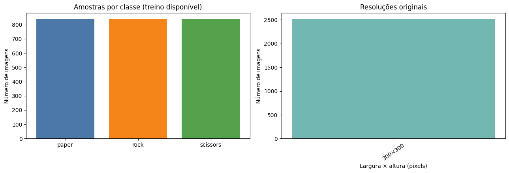
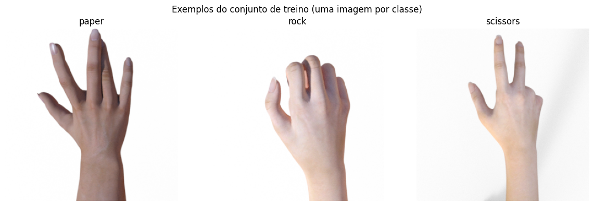
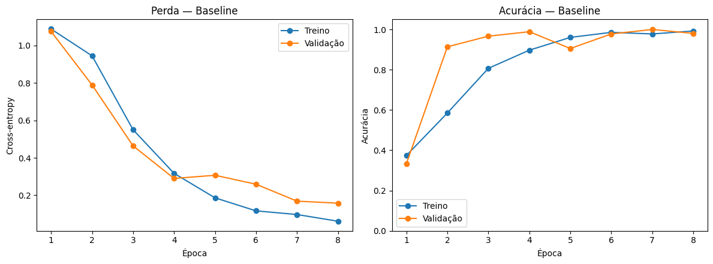
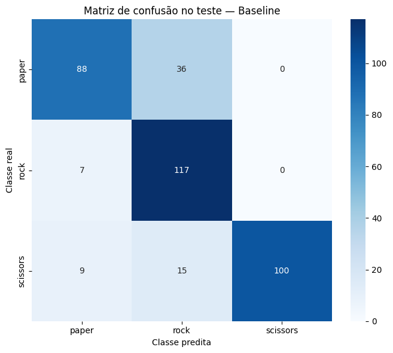
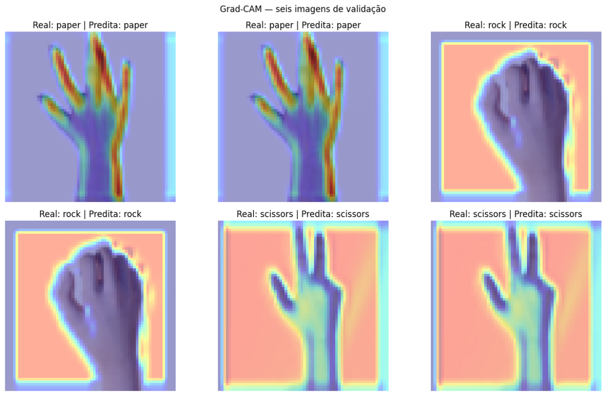

# A Small Convolutional Neural Network for Rock–Paper–Scissors Image Classification

*An article-style description of the Model 09 educational research project*

## Summary

This project investigates the use of a compact, custom convolutional neural network (CNN) to classify images of three hand gestures: **paper**, **rock**, and **scissors**. The workflow is implemented in PyTorch and combines exploratory data analysis, a capture-sequence-aware train/validation split, a from-scratch baseline CNN, four controlled experiments, validation-based model selection, Grad-CAM visualization, and a single final evaluation on the official test set.

The selected baseline reached **81.99% accuracy** on 372 test images. Although its best validation checkpoint achieved 100% accuracy, the lower test score highlights the difference between performance on a small validation split and generalization to a separate dataset. The experiment is intended as a reproducible educational case study, not as evidence of production readiness or a new general-purpose machine-learning library.

**Figure 1.** The 2,520 inspected training images are evenly distributed across classes. All were readable, RGBA, and 300 × 300 pixels before preprocessing. Plot labels are retained from the original Portuguese-language notebook.

## Statement of need

Image classification projects often report a high score without making it clear how the data were partitioned, whether related images crossed partition boundaries, or whether the test set influenced model selection. Such choices can make results difficult to interpret, particularly when a dataset contains consecutive frames from the same capture.

This project addresses those concerns in a small, inspectable assignment-scale workflow. It groups training images by the capture-sequence prefix encoded in their filenames and holds out whole sequences for validation. All experiments use the same seeded partition; validation selects the model; and the official test set is evaluated only after selection, in one final pass. The notebook also reports class-level metrics and visual explanations rather than relying on accuracy alone.

The intended audience is students and instructors learning image classification, CNN architecture, experiment design, and evaluation. The contribution is pedagogical and methodological: a complete example whose data preparation, architectural choices, hypotheses, results, and limitations can be reviewed in one notebook.

## Introduction

A CNN learns spatially local image patterns through convolutional filters. Early layers can respond to edges and contours; deeper layers combine such responses into more complex shapes. Pooling reduces feature-map size, while a classifier maps the learned representation to class scores.

Here, the network receives an RGB image of a hand and predicts one of three gestures. It is built layer by layer in PyTorch without pretrained weights. The research question is:

> **How well can a small CNN trained from scratch classify rock–paper–scissors gestures, and how do simple changes to augmentation, regularization, and network depth affect validation and test performance?**

The experiment is deliberately bounded. It compares five configurations on one fixed, group-aware split and reports an untouched test result. It does not claim statistically conclusive model rankings across many random seeds or capture splits.

**Figure 2.** One training example per class. These images illustrate the gesture labels and the relatively consistent capture style; they are examples, not evidence that the full dataset represents all real-world hands or environments.

## Dataset and exploratory analysis

The notebook uses the Rock-Paper-Scissors image collection distributed for TensorFlow's educational materials. The training archive contains 2,520 images: 840 in each class. All inspected training images were readable and measured 300 × 300 pixels in RGBA mode. Model inputs are resized to 64 × 64 pixels to reduce computation.

The equal class counts mean that no frequency imbalance was observed in the training partition. However, balance alone does not establish diversity or fairness. The images have regular dimensions and capture conditions, and the dataset does not provide reliable demographic metadata. Consequently, representation across demographic groups cannot be assessed, and generalization to different lighting, backgrounds, framing, cameras, or hand appearances remains uncertain.

### Partitioning and leakage prevention

Image filenames encode a capture-sequence prefix and a frame number. Neighboring frames from one sequence may be visually correlated, so splitting individual frames at random could place near-duplicates in both training and validation. The notebook instead holds out one whole sequence per class for validation, using random seed `42`.

| Partition | Capture sequences | Images | Images per class |
|---|---:|---:|---:|
| Training | 18 | 2,160 (85.7%) | 720 |
| Validation | 3 | 360 (14.3%) | 120 |
| Official test | Separate official set | 372 | 124 |

The train/validation proportion follows the available group structure rather than an exact 80/20 target. Notebook assertions verify group and image-index disjointness, complete assignment of training images, and representation of all classes in both partitions. The official test data are not used in exploratory analysis, experiment comparison, or checkpoint selection.

## Software design

The implementation is a self-contained Jupyter notebook rather than a packaged application. It uses `torchvision.datasets.ImageFolder` for folder-based labels and a custom `torch.nn.Module` for the network. The choice to implement the CNN directly, rather than use transfer learning, keeps each convolution, activation, pooling operation, and classifier layer visible to students.

### Architecture

The baseline accepts a `3 × 64 × 64` RGB tensor and has **71,139 trainable parameters**.

| Layer or operation | Output shape (channels × height × width) | Purpose |
|---|---:|---|
| RGB input | `3 × 64 × 64` | Three color channels |
| 3 × 3 convolution, 16 filters, padding 1; ReLU | `16 × 64 × 64` | Learn local features while preserving spatial dimensions |
| 2 × 2 max-pooling, stride 2 | `16 × 32 × 32` | Reduce spatial size and computation |
| 3 × 3 convolution, 32 filters, padding 1; ReLU | `32 × 32 × 32` | Combine features into richer patterns |
| 2 × 2 max-pooling, stride 2 | `32 × 16 × 16` | Further reduce spatial size |
| Adaptive average pooling to 4 × 4 | `32 × 4 × 4` | Produce a compact fixed-size representation |
| Flatten | `512` | Convert feature maps to a vector |
| Fully connected layer; ReLU | `128` | Combine the learned visual features |
| Fully connected output | `3` logits | Score paper, rock, and scissors |

The 3 × 3 kernels capture local structure, ReLU supplies non-linearity, and max-pooling reduces the feature-map area. Increasing the channel count from 16 to 32 allows the second block to represent richer combinations. Adaptive pooling and a compact classifier limit the size of the baseline.

### Training and controlled experiments

Each model uses batch size 64, Adam with learning rate `0.001`, cross-entropy loss, and up to 8 epochs. Python, NumPy, and PyTorch seeds are set to `42`; data loaders use seeded generators and `num_workers=0`. Validation and test transformations are deterministic. Augmentation, when enabled, is applied only to training images.

The baseline is compared with four variants. Partitions, input size, optimizer, learning rate, batch size, and epoch budget are held constant; each variant changes one factor.

| Configuration | Hypothesis tested | Best validation epoch | Validation accuracy | Validation loss | Interpretation |
|---|---|---:|---:|---:|---|
| Baseline | A compact CNN can learn the basic gesture patterns | 7 | 1.000 | 0.1687 | Selected; lower loss than augmentation at the same accuracy |
| Data augmentation | Horizontal flips and rotations up to 15° may reduce reliance on exact pose | 5 | 1.000 | 0.3275 | Tied on accuracy; did not win the loss tie-break |
| Dropout | Dropout (`p = 0.5`) may reduce co-adaptation and overfitting | 4 | 0.989 | 0.3546 | Below baseline validation accuracy |
| Batch normalization | Normalizing convolutional activations may stabilize optimization | 1 | 0.864 | 0.8362 | Training accuracy rose to 1.000 while validation degraded |
| Increased depth | An additional 64-filter block may learn more complex features | 4 | 0.950 | 0.1644 | Lower loss than the selected baseline checkpoint, but lower accuracy |

Checkpoints are ranked first by validation accuracy and, for ties, by validation loss. The baseline was therefore selected without consulting the test set. In this run, added regularization or capacity did not improve the primary validation selection metric.

**Figure 3.** Baseline learning curves. Accuracy rises quickly on the held-out validation sequences, while the loss curves retain useful information about confidence and model fit. The plotted labels are retained from the original Portuguese-language notebook.

### Evaluation and interpretability

The final selected checkpoint is evaluated once on the official test set. The notebook reports:

- **Accuracy:** fraction of all predictions that are correct.
- **Precision:** fraction of predictions assigned to a class that are correct.
- **Recall:** fraction of actual examples of a class that are recovered.
- **F1-score:** harmonic mean of precision and recall.
- **Confusion matrix:** counts of actual versus predicted labels.

Class accuracy is also reported; for this single-label classification setting it is equivalent to per-class recall. Grad-CAM heatmaps are generated for six validation images (two per class), not for test images. These visualizations are qualitative and approximate; they do not prove causal feature use or explain the test-set errors.

## Results

### Expected behavior

Before training, the working hypotheses were that a small CNN would learn useful shape and contour features from this balanced dataset, and that data augmentation, dropout, batch normalization, or additional depth might improve validation performance. These are hypotheses rather than promised outcomes. Given the small number of held-out capture sequences, perfect validation accuracy was not expected to guarantee equally strong test performance.

### Observed test performance

The selected baseline achieved **81.99% accuracy (305/372 correct)** on the one-time final test evaluation. Macro precision was approximately **0.848**, macro recall **0.820**, and macro F1-score **0.822**.

| Actual class | Precision | Recall | F1-score | Support |
|---|---:|---:|---:|---:|
| Paper | 0.8462 | 0.7097 | 0.7719 | 124 |
| Rock | 0.6964 | 0.9435 | 0.8014 | 124 |
| Scissors | 1.0000 | 0.8065 | 0.8929 | 124 |

**Figure 4.** Test confusion matrix for the selected baseline (rows: actual class; columns: predicted class). The largest off-diagonal entry is paper classified as rock (36 images).

Paper had the lowest recall: 88 of 124 paper images were correctly classified, while 36 were classified as rock. Rock recall was high (117 of 124), but rock precision was lower because images from the other classes were also predicted as rock. Scissors precision was 1.000 on this test split, while 24 actual scissors images were assigned to paper or rock.

The 18.01 percentage-point gap between perfect best-checkpoint validation accuracy and test accuracy is central to the interpretation. It indicates that validation results on three held-out sequences did not fully predict performance on the official test set. This observation should motivate better evaluation data, not tuning against the test set.

**Figure 5.** Grad-CAM maps for six validation examples. Warm-colored areas indicate regions associated with the predicted class score. The maps are qualitative: broad activation around the hand, background, or image boundaries should be treated as a prompt for investigation, not proof of a shortcut or causal explanation. Labels are retained from the original Portuguese-language notebook.

## State of the field

PyTorch and torchvision provide mature building blocks for image classification, including dataset loaders and general-purpose tensor operations. Transfer learning and pretrained image models are common alternatives when the goal is to maximize accuracy or reduce training time on a small labeled dataset.

This project does not attempt to replace those tools or introduce a new CNN technique. Instead, it implements a small network directly to make the architecture and experiment changes inspectable. That build-versus-reuse choice is appropriate for a teaching objective—understanding convolution, pooling, controlled experiments, and evaluation—but would not by itself justify a custom architecture for a production application. The comparison with a pretrained model is outside the scope of the assignment.

## Research impact statement

The demonstrated impact is educational and local to this project: the notebook provides a reproducible, inspectable example of group-aware validation, controlled CNN experiments, class-level error analysis, and qualitative model inspection. The observed validation-to-test gap and paper-to-rock confusion offer concrete discussion points for a machine-learning course.

No external adoption, peer-reviewed validation of this project, or deployment evidence is claimed. The single test result is specific to this dataset and split and should not be interpreted as a benchmark for general hand-gesture recognition.

## Quality control and reproducibility

The complete notebook was executed in the project environment: **14 code cells completed without cell errors**. It sets fixed seeds, uses explicit split assertions, creates the experiment table from measured results, and keeps the official test evaluation in the final analysis stage. A successful local run does not guarantee bit-for-bit identical results on every hardware and library combination.

To reproduce the workflow:

1. Open [`main_notebook.ipynb`](./main_notebook.ipynb) in Jupyter or VS Code.
2. Select a Python environment with PyTorch, torchvision, scikit-learn, Pillow, Matplotlib, Seaborn, NumPy, and Jupyter/IPython installed.
3. Use **Restart Kernel and Run All** and allow training and final evaluation to finish.

The notebook does not install dependencies silently. It uses the expected local data folders if present; if either is missing, it downloads and extracts the corresponding archive. Internet access is therefore required for initial dataset preparation.

## Availability

The repository contains:

- [`main_notebook.ipynb`](./main_notebook.ipynb): exploratory analysis, data splitting, CNN implementation, experiments, Grad-CAM, and final evaluation.
- [`apresentacao_modelo_09.pptx`](./apresentacao_modelo_09.pptx): presentation of the project and results.
- [`docs/images/`](./docs/images/): figures used in this article-style README.
- `dataset/`: local dataset archives and extracted image folders, used or populated by the notebook as needed.

Training and test archives:

- [`rps.zip`](https://storage.googleapis.com/tensorflow-1-public/course2/week4/rps.zip)
- [`rps-test-set.zip`](https://storage.googleapis.com/tensorflow-1-public/course2/week4/rps-test-set.zip)

## AI usage disclosure

AI assistance was used during development of the notebook and preparation of this README and the project presentation. The notebook includes a more detailed usage log and records critical corrections made during the project. The project authors should review the code and results themselves and follow their course or institution's requirements for disclosing AI assistance.

## Acknowledgements

We acknowledge Laurence Moroney and the TensorFlow educational materials for providing the Rock-Paper-Scissors dataset used in this project. We also thank the authors of the JOSS example papers consulted for demonstrating a concise, software-centered article structure. This README adopts that organizational style; it is **not** a JOSS submission, accepted paper, or peer-reviewed publication.

## References

1. TensorFlow educational materials. *Rock-Paper-Scissors dataset*. [Training archive](https://storage.googleapis.com/tensorflow-1-public/course2/week4/rps.zip); [test archive](https://storage.googleapis.com/tensorflow-1-public/course2/week4/rps-test-set.zip).
2. Selvaraju, R. R., Cogswell, M., Das, A., Vedantam, R., Parikh, D., and Batra, D. (2017). Grad-CAM: Visual Explanations from Deep Networks via Gradient-based Localization. *Proceedings of the IEEE International Conference on Computer Vision (ICCV)*, 618–626. <https://doi.org/10.1109/ICCV.2017.74>
3. Paszke, A. et al. (2019). PyTorch: An Imperative Style, High-Performance Deep Learning Library. *Advances in Neural Information Processing Systems 32*. <https://papers.nips.cc/paper/9015-pytorch-an-imperative-style-high-performance-deep-learning-library>
4. Harrison, K., Mendes, M. F., Haasjes, C., and Hein, G. (2026). Optiland: Open-Source Optical Design Software in Python. *Journal of Open Source Software*, 11(127), 11170. <https://doi.org/10.21105/joss.11170>
5. Komarov, P., van Breugel, F., Protogerou, M., and Kutz, J. N. (2026). PyNumDiff: Practical Numerical Differentiation for Noisy Data. *Journal of Open Source Software*, 11(127), 11172. <https://doi.org/10.21105/joss.11172>
6. Candelaresi, S., and Smiet, C. (2026). BlenDaViz, scientific visualization library for Blender in Python. *Journal of Open Source Software*, 11(127), 11181. <https://doi.org/10.21105/joss.11181>
